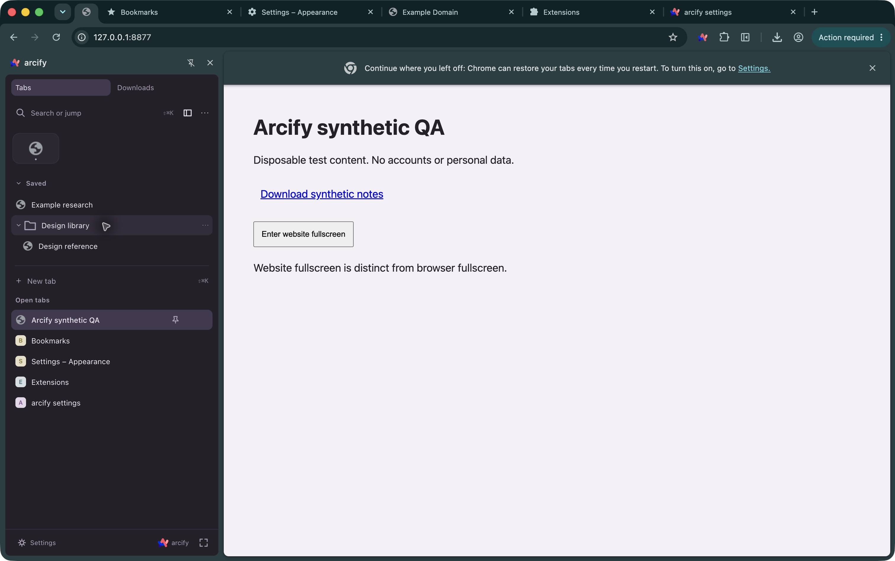

# arcify

A local-first Chrome sidebar and command palette, inspired by Arc's hierarchy. MIT licensed; no backend, account, telemetry, remote assets, or runtime dependencies.

**Development preview — native Chrome acceptance is incomplete.** The actual unpacked build has now been tested in a signed-out disposable Chrome profile. 62 automated tests, 37 rendered checks and 9 of 24 acceptance rows pass; 15 rows remain incomplete or blocked. See the [native evidence](docs/NATIVE-QA.md), including unresolved cold-worker/fullscreen-focus cases. Do not treat this as a completed release. See [QA report](docs/QA.md) and [acceptance matrix](docs/ACCEPTANCE.md).

## Installed Chrome evidence



[Light sidebar](docs/qa/native/sidebar-left.jpg) · [Downloads](docs/qa/native/downloads.jpg) · [Browser fullscreen](docs/qa/native/fullscreen-regression.jpg) · [Native report](docs/NATIVE-QA.md)

## Implemented UI previews

These images render the actual bundled UI with synthetic Chrome API fixtures in headless installed Chrome. They are not screenshots of an installed extension and do not prove native behavior.

[Light sidebar](docs/qa/arcify-sidebar-light.png) · [Dark sidebar](docs/qa/arcify-sidebar-dark.png) · [Light palette](docs/qa/arcify-palette-light.png) · [Dark palette](docs/qa/arcify-palette-dark.png) · [Appearance editor](docs/qa/arcify-appearance-editor.png)

## Build and load

Tested development environment: Node **26.8.1**, npm **11.19.0**, macOS **26.6.2** (Apple M1 Pro). Minimum Chrome **142**; installed Chrome on the test machine is **156.0.8078.48**. Windows and Linux are untested.

```sh
npm ci --ignore-scripts
npm run check
```

Dependencies may require internet access at build time. `dist/` is committed and loadable without building. There are no runtime packages or requests. `npm run build` reproducibly packages the four entry points and local assets; `npm test` runs unit/security and mock-worker integration tests; `npm run benchmark` runs the synthetic search benchmark.

1. Use a disposable Chrome profile first, with synthetic bookmarks only.
2. Open `chrome://extensions`, enable Developer mode, choose **Load unpacked**, and select this repository's **dist** directory. Enterprise policy may require administrator approval; do not bypass it.
3. Open arcify from the toolbar. Use **Settings** to choose a bookmark folder. The default uses Chrome's `folderType` data, not a translated title or hardcoded ID.
4. After rebuilding, click **Reload** on the arcify card in `chrome://extensions`, then reopen the panel and popup.

Suggested shortcuts: **Command+Shift+K** palette and **Command+Shift+Y** sidebar on macOS; **Control+Shift+K/Y** elsewhere. Chrome decides whether these are assigned. arcify Settings shows `commands.getAll()` results or **Not assigned**. Configure them at `chrome://extensions/shortcuts`. Physical open/close shortcuts were verified on running Chrome 155/macOS; cold-worker behavior remains a separate incomplete gate.

Search supports `>` actions, `@` tabs and `#` bookmarks. Up/Down selects, Enter activates, and Command+Enter/Control+Enter deliberately opens a new tab. Search never goes to a web search service. An explicit HTTP(S) URL or recognisable domain offers Open URL. Context menus distinguish Close live tab, Remove from favourites and Delete bookmark. Bookmark writes require an explicit user action; installation does not edit bookmarks.

## Permissions and privacy

Exactly `tabs`, `bookmarks`, `storage`, `sidePanel`, `favicon`, `downloads`. No host permissions or content scripts. `tabs` exposes titles and URLs, and Chrome may describe it as reading browsing history; it does not grant DOM access. `bookmarks` grants reading and writing together—Chrome has no read-only version. Preferences use `storage.local`, associations use `storage.session`; never `storage.sync`. Chrome itself may sync native bookmarks under existing browser settings.

All resources are packaged. The explicit CSP disallows connections and remote code. Permission restrictions are not a mathematical exfiltration guarantee: navigating to a user-selected URL can transmit data to that destination. arcify never attaches context to destinations. See [PRIVACY](PRIVACY.md) and [SECURITY](SECURITY.md).

## Differences from Arc and known limitations

Chrome owns the side-panel header, width and placement. Choose left/right under Chrome Settings → Appearance. The palette is a native toolbar popup, not a centred webpage overlay. arcify does not hide native tabs, inject into websites, archive tabs, implement Spaces, or provide web search. Normal browser fullscreen and website fullscreen were observed separately. Multi-window fullscreen focus, video fullscreen and complete state-restoration acceptance remain unresolved.

Incremental bookmark/tab stores and search updates, bounded tree pagination, and keyboard move/reorder equivalents are implemented. Native drag/drop permutations, worker suspension, full restart and policy edge cases remain incomplete. Bounded native page/worker network traces are documented, without claiming universal coverage. Synthetic rendered input-to-layout performance meets the target; this is not a native popup measurement.

Use **Customize appearance…** in a tab, favourite, bookmark or folder context menu (Shift+F10 is supported) for a local name, emoji or local raster image. Reset to original preserves bookmarks. Saved-item overrides persist by bookmark ID; live-tab overrides use session storage, follow navigation/replacement and disappear on close or browser restart. PNG/JPEG/WebP inputs are limited to 2 MB and 4096 pixels per dimension, re-encoded as PNG at most 128 pixels, with a 2 MB customization budget. Native bookmark rename remains a separate action.

System theme reacts to browser/system `prefers-color-scheme`; explicit light/dark overrides are available. Chrome custom-theme colour values are not exposed through this permission contract. Approved `favicon` permission uses Chrome's extension-local cache endpoint, with packaged/monogram fallbacks on load failure. A cache miss can return Chrome's generic icon. Native cached endpoint requests and generic cache-miss icons were observed. Bounded worker traffic inspection was empty; comprehensive traffic coverage remains incomplete. Arc logo and packaged third-party icons have separate provenance in [THIRD_PARTY_ASSETS](THIRD_PARTY_ASSETS.md); source MIT does not relicense those assets.

Reset preferences preserves bookmarks. Uninstall removes extension storage but does not undo user-confirmed native bookmark edits. No Chrome Web Store publication or auto-updater is configured.

## Contributing

See [CONTRIBUTING](CONTRIBUTING.md), [architecture](docs/ARCHITECTURE.md), and the preserved [complete implementation brief](docs/IMPLEMENTATION-BRIEF.md). Use synthetic data in issues and evidence.

Downloads uses the explicitly approved downloads permission. The sidebar and palette show at most 50 recent records, with filenames, status and progress held in memory only. No download contents, full paths or source URLs are stored or transmitted. Reveal is user initiated and does not execute the file; Manage opens Chrome's downloads page. No downloads.open, automatic downloads, file deletion, history erasure or external services. Updates use events plus a one-second refresh while an active transfer is present in an open UI. Chrome's existence flag can lag; Reveal re-queries the record. Official API contract: https://developer.chrome.com/docs/extensions/reference/api/downloads .
